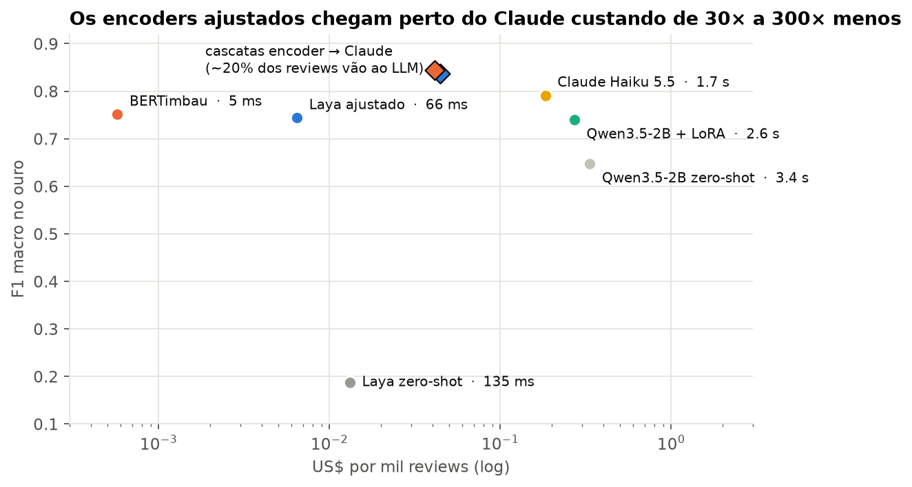
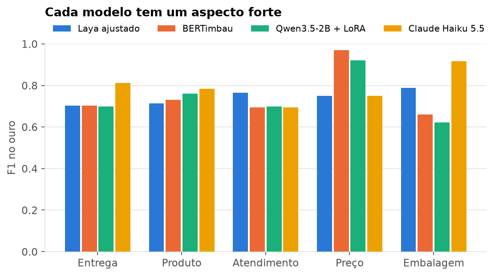
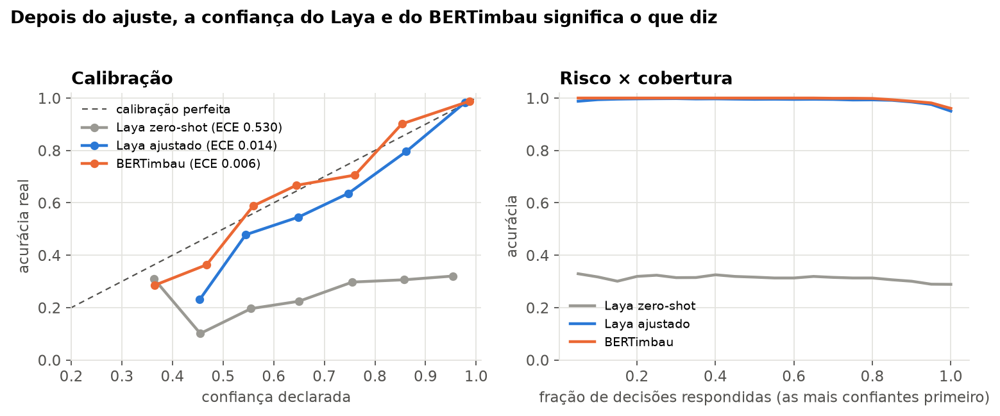
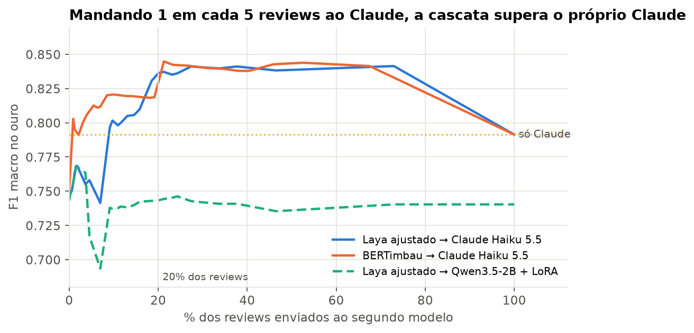
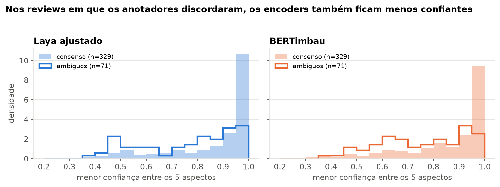

<div align="center">

# Review Intelligence PT-BR

### Um encoder de 322M que lê reviews em português, diz o quanto confia na resposta e, em cascata, supera o LLM que o ensinou.

[](https://huggingface.co/RenatoSpessotto/laya-aspectos-reviews-ptbr)
[](https://huggingface.co/RenatoSpessotto/bertimbau-aspectos-reviews-ptbr)
[](https://huggingface.co/RenatoSpessotto/qwen3.5-2b-aspectos-reviews-ptbr-lora)
[](https://huggingface.co/datasets/RenatoSpessotto/olist-aspectos-reviews-ptbr)
[](pyproject.toml)
[](docker-compose.yml)

</div>

> **Projeto experimental.** O objetivo foi testar o **[Laya](https://huggingface.co/convaiinnovations/laya)** (Convai, set/2026), um encoder de decisão aberto que devolve probabilidades calibradas, numa tarefa real em português. O **BERTimbau** entra como baseline clássico. Um LLM pequeno ajustado (Qwen3.5-2B) e o Claude servem de referência.

A tarefa é ler uma avaliação de compra da Olist e dizer como o cliente avalia cinco aspectos: **entrega, produto, atendimento, preço e embalagem**. Para cada um, o rótulo é positivo, negativo, neutro ou ausente.

O Claude Haiku 5.5 rotulou 10 mil reviews, e os modelos pequenos aprenderam com esses rótulos. Todos foram avaliados num conjunto ouro independente.

| **0,19 → 0,74** | **0,014** | **0,84** | **20%** |
|:---:|:---:|:---:|:---:|
| F1 do Laya antes e depois do fine-tuning | erro de calibração (ECE) do Laya | F1 da cascata Laya → Claude (Claude sozinho: 0,79) | dos reviews precisam ir ao Claude |



## Experimente

```bash
docker compose up --build
# demo:  http://localhost:7860   Laya x BERTimbau lado a lado, com confiança e decisão da cascata
# API:   http://localhost:8000/docs   POST /extract {"text": "..."}
```

Os modelos são baixados do Hugging Face na primeira chamada. Em Python:

```python
from review_intel.models.registry import load   # pip install -e .

laya = load("laya-ft")    # ou "bertimbau"
pred = laya.predict(["Produto ótimo, mas chegou com 10 dias de atraso e a caixa toda amassada."])[0]
pred.analysis["aspectos"]  # {'entrega': 'negativo', 'produto': 'positivo', ..., 'embalagem': 'negativo'}
pred.confidence            # {'entrega': 0.97, 'produto': 0.98, ..., 'embalagem': 0.96}
```

O notebook **[01_testes_dos_modelos.ipynb](notebooks/01_testes_dos_modelos.ipynb)** roda os dois modelos ao vivo numa bateria de casos: fáceis, mistos, ironia, texto curtíssimo e fora do domínio. Ele termina com asserts de sanidade.

## Laya e BERTimbau, frente a frente

| | **Laya ajustado** | **BERTimbau ajustado** |
|---|---|---|
| Parâmetros | 322M (encoder mmBERT) | 110M |
| F1 macro no ouro | 0,744 | **0,751** |
| F1 na validação (rótulos do Haiku) | **0,737** | 0,693 |
| Aspectos em que é o melhor aluno | **atendimento (0,77), embalagem (0,79)** | **preço (0,97)** |
| Calibração (ECE) | 0,014 | **0,006** |
| Latência p50 (Mac M4) | 66 ms | **5 ms** |
| Cascata com o Claude (limiar 0,75) | F1 0,836 com 20% ao LLM | F1 0,845 com 21% ao LLM |
| Como recebe a tarefa | **pergunta em linguagem natural** | uma cabeça fixa por aspecto |

**O que o Laya traz.**
- **A calibração faz parte do treino.** A temperatura e o limiar de abstenção saem do próprio `laya.train.finetune`.
- **O formato é genérico.** A tarefa entra como pergunta em linguagem natural, então a mesma API serve para qualquer decisão nova, sem mexer na arquitetura.
- **Imita melhor o professor que o BERTimbau.**
- **Sem fine-tuning, não funciona em português.** Ele colapsa numa resposta só, com cerca de 80% de confiança e 29% de acerto. O ajuste com 9 mil exemplos resolve isso.

**O que o BERTimbau traz.**
- **É o mais rápido e o mais barato:** custa cerca de 300 vezes menos que o Claude por review.
- **É o mais bem calibrado** depois do temperature scaling.
- **Tem o melhor resultado no ouro**, por margem pequena.
- **Limite:** cada aspecto novo exige uma cabeça nova e um novo treino.

A diferença entre os dois no ouro (0,744 contra 0,751) está dentro do ruído de 329 reviews. **Eles empatam em qualidade.** A escolha depende do que se valoriza: flexibilidade para novas perguntas (Laya) ou velocidade num conjunto fixo de aspectos (BERTimbau).

## Resultados

| Modelo | F1 macro (ouro) | Latência p50 | US$ / mil reviews |
|---|---|---|---|
| Claude Haiku 5.5 (professor) | **0,791** | 1,7 s | 0,183 |
| **BERTimbau ajustado** | 0,751 | 5 ms | 0,0006 |
| **Laya ajustado** | 0,744 | 66 ms | 0,006 |
| Qwen3.5-2B + QLoRA | 0,740 | 2,6 s | 0,271 |
| Qwen3.5-2B zero-shot | 0,648 | 3,4 s | 0,333 |
| Laya zero-shot | 0,187 | 135 ms | 0,013 |

O custo dos modelos locais é o tempo de GPU a US$ 0,35/h; o do Claude, o custo real dos tokens. As latências foram medidas num Mac M4.

**Cada modelo tem um aspecto forte.** O ouro tem poucos exemplos de preço e embalagem (16 e 13), então o F1 desses aspectos varia muito.



**A confiança dos encoders significa o que diz.** Quando eles respondem só os 80% de decisões em que estão mais confiantes, a acurácia sobe de 95% para mais de 99%.



**A cascata supera o professor.** O encoder decide sozinho quando está seguro e manda o resto ao Claude.
- **Reviews em que o Laya está confiante (263):** o Laya acerta mais que o Claude (F1 0,84 contra 0,80).
- **Reviews em que está inseguro (66):** o Claude é muito melhor (0,80 contra 0,59).
- **O Qwen não serve de segundo estágio.** Nesses mesmos 66 reviews, ele fica em 0,58.

O limiar foi escolhido no próprio ouro, então o número absoluto é otimista. Mesmo assim, a curva fica acima do Claude sozinho em toda a faixa entre 10% e 70% de reviews escalados.



**A confiança percebe ambiguidade.** Nos 71 reviews em que os dois anotadores do ouro discordaram, a fração abaixo do limiar da cascata sobe:
- **Laya:** de 20% para 39%;
- **BERTimbau:** de 21% para 47%.



**Imitar o professor não é o mesmo que acertar o consenso.** Na validação, em que a referência são os rótulos do próprio Haiku, o Qwen é quem mais imita o professor. No ouro, os três alunos empatam ([figura](docs/figures/03_validacao_vs_ouro.png)).

## Quando usar cada um

- **BERTimbau na frente:** aspectos fixos e latência importando.
- **Laya na frente:** quando se espera acrescentar novas perguntas ao longo do tempo, ou se quer a calibração já embutida no treino.
- **Claude como fallback:** para os cerca de 20% de reviews em que o encoder está inseguro. Essa combinação dá a melhor qualidade do projeto.
- **Qwen3.5-2B + LoRA:** para classificar, não compensa.
  - Tem o mesmo F1 dos encoders.
  - É de 40 a 500 vezes mais lento e não tem confiança nativa.
  - Rodando localmente, custa por review mais que a própria API do Haiku.
  - Só se justifica quando se precisa do texto que ele gera: `motivo_principal` e `acao_sugerida`.

## Como foi feito

1. **Dados.** São 36.045 reviews da Olist com texto. Removi as duplicatas e estratifiquei pela nota.
2. **Rótulos prata.** O Claude Haiku 5.5 gerou saída estruturada pela Batch API: 10 mil reviews por **US$ 0,92**.
3. **Conjunto ouro.** São 329 reviews em que dois anotadores LLM independentes e às cegas (Argon e Claude Opus 5.5) concordaram nos 5 aspectos, com kappa médio de 0,86. O guia de anotação, o kappa e as limitações estão em [data/gold/README.md](data/gold/README.md).
4. **Fine-tuning no Colab (L4/A100).** Os três modelos foram treinados com 9 mil reviews:
   - o Laya, com `laya.train`;
   - o BERTimbau, com uma cabeça por aspecto e temperature scaling;
   - o Qwen, com QLoRA via TRL.
5. **Avaliação.** No ouro e na validação prata medi F1 por aspecto, calibração, latência, custo e a cascata.

```
review-intelligence-ptbr/
├── Dockerfile, docker-compose.yml   API (:8000) + demo (:7860)
├── Makefile                         make help lista tudo
├── notebooks/
│   ├── 01_testes_dos_modelos.ipynb  testes ao vivo, Laya x BERTimbau
│   ├── 02_resultados.ipynb          tabelas e figuras deste README
│   └── 03_treino_colab.ipynb        treino dos três modelos
├── src/review_intel/
│   ├── core/          esquema do JSON, prompts, métricas, caminhos
│   ├── models/        Laya, BERTimbau, Qwen, Claude + registry (outputs/ ou Hugging Face)
│   ├── data/          download e preparo da Olist
│   ├── labeling/      rótulos prata e conjunto ouro
│   ├── training/      fine-tuning de cada modelo
│   ├── evaluation/    tabela comparativa, cascata, análises
│   ├── serving/       FastAPI e Gradio
│   └── hub/           publicação no Hugging Face
├── data/gold/         conjunto ouro versionado
├── docs/              figuras, guia de anotação, model cards
└── tests/
```

```bash
make setup            # venv + pip install -e ".[dev]"
make test             # testes unitários (sem GPU e sem API)
make notebook-tests   # executa o notebook de testes ao vivo
make report           # regera as tabelas e as figuras
make gold             # reconstrói o ouro a partir das anotações
make eval cascade     # tabela comparativa e cascata a partir das predições salvas
make help             # todos os comandos
```

## Limitações

- **Ouro anotado por LLMs.** Dois LLMs anotaram o ouro, não pessoas. Um deles é da mesma família do professor, o que pode favorecer os alunos.
- **Números otimistas.** O consenso descarta os casos ambíguos, então os números do ouro saem um pouco otimistas.
- **Ironia engana os dois encoders.** "Parabéns, conseguiram entregar só um mês depois" sai como entrega positiva, com alta confiança.
- **Perguntas novas ao Laya.** Perguntas que ele não viu no treino saem com confiança baixa e respostas inconsistentes. A flexibilidade do formato ainda exige rótulos.
- **Latência do Qwen.** No Mac, o Qwen roda sem os kernels otimizados de atenção linear. Numa GPU com vLLM ele fica mais rápido, mas não chega à ordem de grandeza dos encoders.

**Licenças.**
- **Dados e modelos ajustados:** CC BY-NC-SA 4.0, herdada da Olist, para uso não comercial.
- **Modelos base:** Laya e Qwen são Apache-2.0; BERTimbau é MIT.

---

## English summary

**Experimental project to test [Laya](https://huggingface.co/convaiinnovations/laya)**, a new open decision encoder with calibrated probabilities, on a real Brazilian Portuguese task: aspect-based sentiment on Olist e-commerce reviews.

**Setup.** Claude Haiku 5.5 labeled 10k reviews (US$ 0.92). Laya (322M), BERTimbau (110M) and Qwen3.5-2B (QLoRA) were fine-tuned on those labels. They were evaluated on a 329-review gold set, built from the consensus of two blind LLM annotators (kappa 0.86).

**Results.**
- **Laya:** goes from 0.19 to 0.74 macro F1 with fine-tuning, with ECE 0.014.
- **BERTimbau:** reaches 0.75 and is about 13x faster than Laya. The two are statistically tied.
- **Cascade:** with the encoder first and Claude only when the encoder is unsure, F1 reaches 0.84 against Claude's 0.79, sending about 20% of reviews to the API.
- **Qwen:** the fine-tuned Qwen ties on F1 but is 40 to 500x slower and has no native confidence.

**Try it.** Run `docker compose up`, or use the models on Hugging Face (links above).
